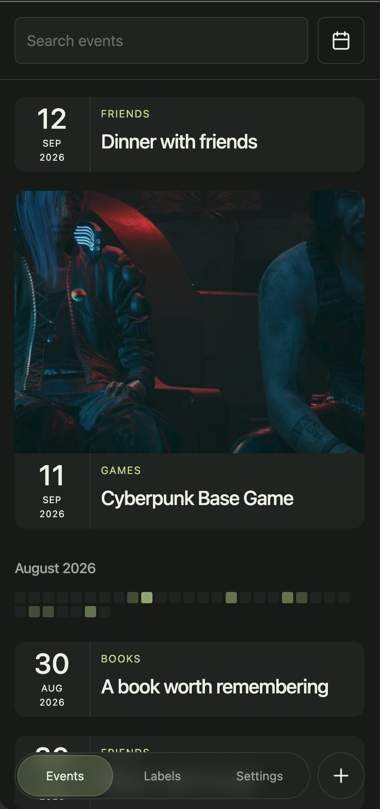
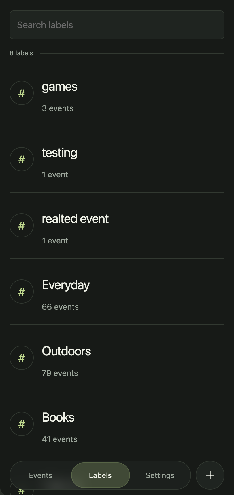
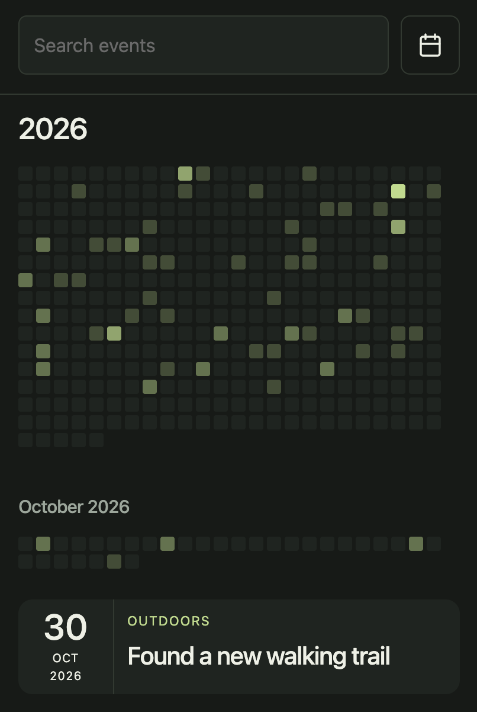

# Limethat

A folder-based journal for your moments, notes, and pictures. Limethat is a progressive web app (PWA): use it in your browser or install it as an app where supported.

Your archive is a folder you choose, not a database hidden inside the app. Events are Markdown (`.md`) files, pictures are ordinary JPEG files, and labels live in JSON. Limethat reads and writes those files directly. No account, backend, or uploads. A disposable browser-local picture cache speeds up repeat viewing; Markdown and labels remain folder-only.

Browse a timeline, search your entries, organize them with labels, and add pictures. Light and dark themes are included.

<p>
  
  
  
</p>

## Your files, your folder

Open an existing archive or create one in an empty folder through Settings, then grant the browser read/write access.

```text
my-archive/
├── manifest.json
├── tags.json
├── moments/
│   └── <date>-<uuid>.md
└── attachments/
    ├── <uuid>.jpg
    └── <uuid>.jpg.thumb.jpg
```

Markdown entries contain a title, text, and JSON-valued front matter for dates, labels, and picture framing. The archive format is shared with the Android app. Back up or move the folder with your own tools; Limethat does not sync it. Use one editor at a time, not simultaneous Android and browser writes.

Direct folder access requires a browser that supports `showDirectoryPicker()` and HTTPS or localhost. Start with a supported desktop Chrome browser; support varies by browser and device. Installing the PWA does not add filesystem support or bypass folder permissions.

Production builds cache the app shell for offline use. IndexedDB also caches displayed picture bytes, up to 64 MiB across archives; clear this cache in Settings without changing archive files. Opening the archive and uncached content still depend on the folder being available and the browser granting access. Installation, offline relaunch, and folder access on physical devices still need validation.

## Development

Use Node 24 and npm. No backend, database, account, or environment secrets to set up.

```sh
npm ci
npm run dev
```

Open `http://localhost:5173/limethat/` and create or open a disposable archive folder. Development runs the real app and writes to the folder you select.

Built with Svelte 5, TypeScript, and Vite. `npm run check` checks types; `npm run build` checks types and builds the static app; `npm run preview` serves the build. None of these commands runs tests.

## Design notes

The code is the reference for implementation details. These notes cover constraints and compatibility decisions that are less obvious from individual functions:

- [Archive compatibility and recovery](docs/archive-compatibility.md): Android format, metadata preservation, conflict detection, and non-atomic writes.
- [Image framing](docs/image-framing.md): Android-compatible coordinates and non-destructive picture positioning.

## License

Limethat is licensed under the [PolyForm Noncommercial License 1.0.0](LICENSE). You may use, modify, and share it for noncommercial purposes, including personal use. The license also permits use by the noncommercial organizations it lists. Commercial use requires separate permission.

The software is provided **as is**, without warranty or liability to the extent permitted by law. Use it at your own risk.

This is source-available software, not open source. Third-party dependencies remain under their own licenses.
